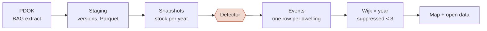

# Housing Conversion Monitor NL

[](https://NathanChen-Analyst.github.io/housing-conversion-monitor-nl/)

**Where did offices become homes?** Every dwelling created out of former office space in the Netherlands since 2012 — 49,362 of them — detected from the version history of the national building register (Kadaster BAG) and mapped per neighbourhood (wijk).

**→ Interactive map:** https://NathanChen-Analyst.github.io/housing-conversion-monitor-nl/

[](https://github.com/NathanChen-Analyst/housing-conversion-monitor-nl/actions)


 

---

## The problem

The Netherlands adds roughly ten thousand dwellings a year without building anything: offices, shops and schools are converted. Nobody publishes *where*. CBS reports national and municipal totals; developers, investors and municipalities want the neighbourhood, the year and the trend. The BAG register contains the answer, but only implicitly, scattered across tens of millions of versioned records.

This project turns that register into a neighbourhood-level, yearly, openly licensed dataset and a map anyone can read.

## Pipeline



- **Storage**: raw → staging → marts, Parquet + DuckDB; the BAG modelled as a type-2 SCD with validity and registration time — [`docs/data-model.md`](docs/data-model.md)
- **Ingest**: monthly mutation files merged idempotently, with a ledger — [`mutations.py`](src/hcm/mutations.py)
- **Orchestration**: Dagster asset graph, 2 asset checks, monthly schedule, run log — [`orchestration/`](orchestration/)
- **Quality**: pandera schemas, SCD2 invariants, disclosure rule, CBS reconciliation; errors block publishing — [`quality.py`](src/hcm/quality.py), [report](https://NathanChen-Analyst.github.io/housing-conversion-monitor-nl/quality.html)
- **SQL**: dbt on DuckDB, 6 models, 21 tests — [`dbt/`](dbt/); analysis queries — [`sql/`](sql/)
- **Runs anywhere**: synthetic sample → full pipeline in CI and in Docker; the real extract and the private detector plug in unchanged

The detector implements the CBS *transformatie* definition and is private until the paper is published; the repo ships an illustrative one so everything runs end to end. Full write-up: [`docs/architecture.md`](docs/architecture.md).

| Stack | |
|---|---|
| Storage & compute | Parquet, DuckDB; HPC cluster for parse and detection |
| Transformation | Python, pandas, dbt-duckdb |
| Geospatial | GeoPandas, Shapely |
| Orchestration | Dagster |
| Quality & tests | pandera, pytest (29), dbt tests (21), ruff, GitHub Actions |
| Delivery | D3 static site on GitHub Pages, Docker |

## Data published here

| File | Content | Licence |
|---|---|---|
| `docs/data/wijk_year_conversions.json` | wijk × year counts (suppressed <3), exact national series | CC BY 4.0 |
| `docs/data/wijken.geojson` | wijk boundaries, CBS 2012 vintage, simplified 50 m | CC BY 4.0 (CBS) |

Sources: Kadaster BAG (CC0), CBS Wijk- en buurtkaart 2012 (CC BY 4.0). No building-level records are published.

Cite as: *Chen, N. (2026). Housing Conversion Monitor NL. https://github.com/NathanChen-Analyst/housing-conversion-monitor-nl*

## Validation

*Placeholder: office-derived dwellings per year against the CBS transformaties series by original use. Chart and reconciliation notes to follow.*

## Roadmap

- One-year-ahead forecast per wijk (pipeline in `src/hcm/model.py`, results pending validation)
- Province outlines on the map
- Municipal permit-to-occupancy durations from the register's own timestamps

## Reproduce

```bash
git clone https://github.com/NathanChen-Analyst/housing-conversion-monitor-nl
cd housing-conversion-monitor-nl
python -m venv .venv && source .venv/bin/activate
make install          # pip install -e ".[all]"
make test             # 29 unit tests
make sample           # synthetic BAG-like data
make pipeline         # materialise every Dagster asset
make quality          # docs/quality.html
make dbt              # dbt build: 6 models, 21 tests
make dagster          # UI at localhost:3000
```

Or: `docker build -t hcm . && docker run --rm hcm`.

The real BAG extract is not included (tens of GB, free from PDOK). Place staging Parquet in `data/staging/` with the schema in `docs/data-model.md` and the same commands run on it.

## Repository layout

```
docs/               site · poster.html · data-model.md · method.md · quality.html (generated)
src/hcm/            staging · mutations · detector · geo · export_public · quality · features · model · cli
orchestration/      Dagster definitions (assets, checks, schedule)
dbt/                dbt-duckdb project: staging → intermediate → marts, schema tests
sql/                analysis.sql · features.sql
scripts/            make_sample_data.py · make_public_data.py
tests/              29 tests: detection edge cases, SCD2 snapshots, idempotent merge, quality, leakage, time split
data/               raw/ · staging/ · marts/  (git-ignored; regenerated by `hcm sample`)
Dockerfile · Makefile · pyproject.toml · config.yaml · .pre-commit-config.yaml · CHANGELOG.md
```

## Author

Nathan Chen — PhD candidate in Economic Geography, University of Groningen. Code MIT, data CC BY 4.0.
